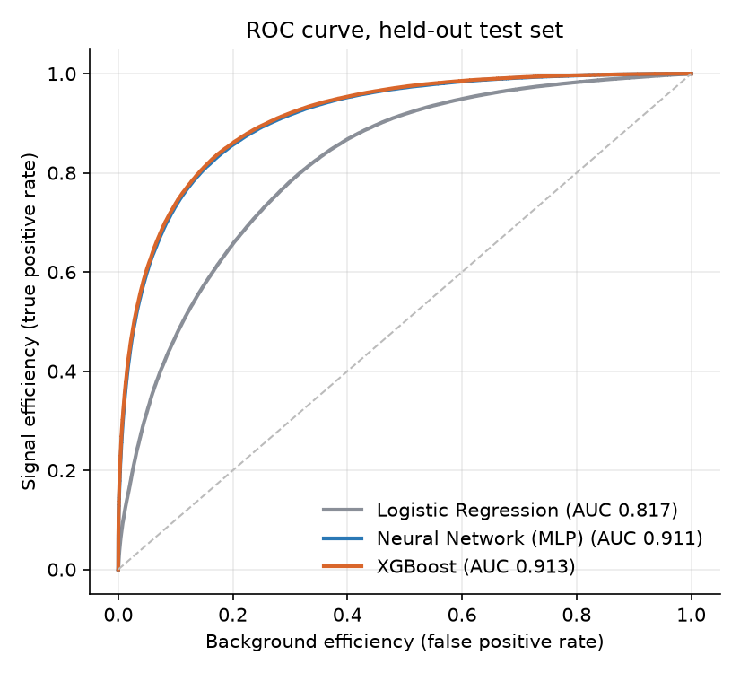
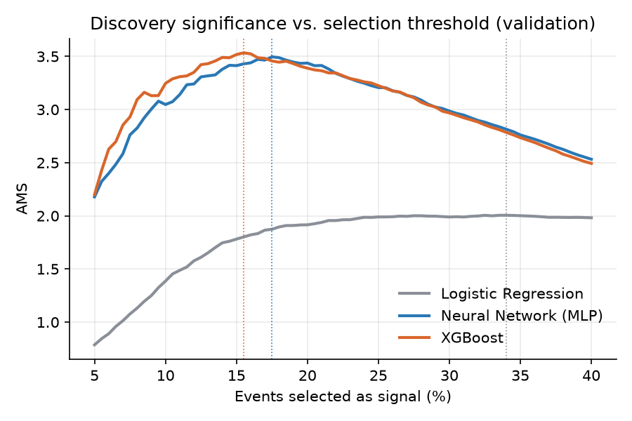
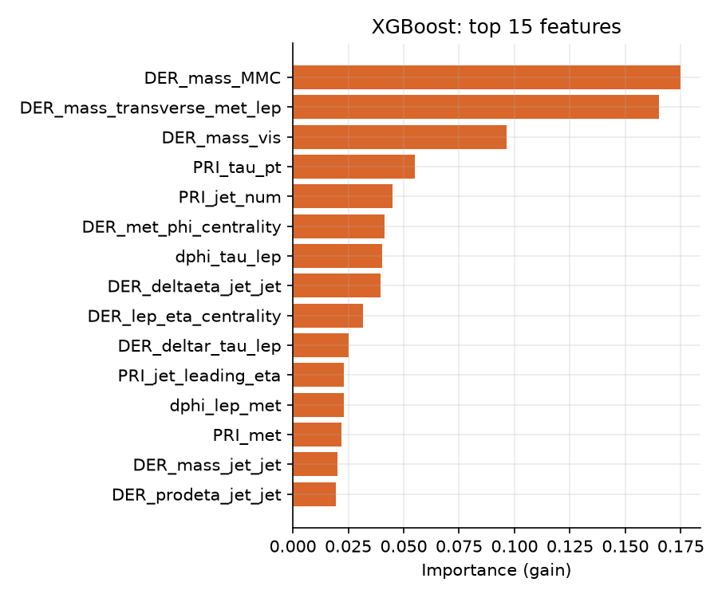
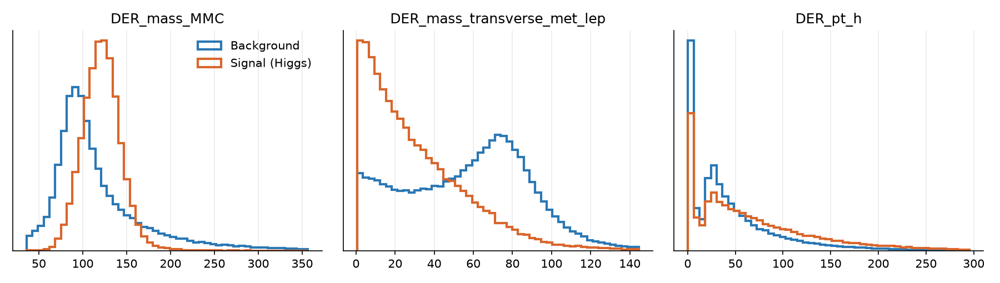

# Higgs Boson Event Classification with CERN Open Data

Machine-learning classifiers that separate **Higgs boson signal events** from **background** in simulated
proton–proton collisions from the **ATLAS experiment at CERN**, evaluated with the physics metric used
by ATLAS physicists: the **Approximate Median Significance (AMS)**.


## The problem

When the Large Hadron Collider smashes protons together, a Higgs boson is produced in only a tiny
fraction of collisions. It decays almost instantly, so physicists never see it directly; they see the
particles it decays into. Here the decay is **H → ττ** (two tau leptons), which is hard because several
ordinary processes (Z → ττ, top-quark pairs, W bosons) leave almost identical traces in the detector.

The task: given 30 measurements of a collision event, decide whether it is **signal** (a Higgs) or
**background**, so that the selected events give the strongest possible statistical evidence for the Higgs.

## Data

[ATLAS Higgs Boson Machine Learning Challenge 2014](https://opendata.cern.ch/record/328), CERN Open Data
Portal ([DOI:10.7483/OPENDATA.ATLAS.ZBP2.M5T8](https://doi.org/10.7483/OPENDATA.ATLAS.ZBP2.M5T8)).

- **818,238 simulated events**, each with 30 features: 17 primary detector measurements (`PRI_*`:
  momenta, angles, missing energy, jets) and 13 derived physics quantities (`DER_*`: invariant masses,
  transverse momenta, angular separations).
- Each event has a **physics weight** so that the simulated sample matches real expected rates;
  signal is far rarer in reality than in the file.
- I use the challenge's **official split**: 250k training, 100k validation (threshold tuning),
  450k held-out test, so results are comparable with published work.

## Approach

1. **Physics-aware feature engineering** (`src/higgs/features.py`)
   - Values of −999 mean "undefined for this event" (e.g. no jets). Converted to missing values, with an
     indicator feature, because *missingness itself carries information*.
   - Absolute azimuthal angles (φ) are replaced by **relative angles** between the tau, lepton and missing
     energy. The detector is symmetric in φ, so only differences carry physics.
   - **Log transforms** for heavily skewed momentum features.
2. **Three models** of increasing capacity (`src/higgs/models.py`): logistic regression (baseline),
   a two-layer neural network, and gradient-boosted trees (XGBoost).
3. **Evaluation with AMS** (`src/higgs/metrics.py`). ROC AUC measures ranking quality, but physicists care
   about *discovery significance*:

   ```
   AMS = sqrt( 2 * ( (s + b + 10) * ln(1 + s / (b + 10)) - s ) )
   ```

   where *s* and *b* are the weighted signal and background events the classifier selects. The selection
   threshold is tuned on the validation set only, then applied once to the untouched test set.

## Results

<!-- RESULTS:START -->
_Results are generated automatically by the training workflow on the full dataset._
<!-- RESULTS:END -->

| ROC curve | AMS vs. selection threshold |
| --- | --- |
|  |  |

| Most important features | Signal vs. background |
| --- | --- |
|  |  |

**Reading the distributions:** `DER_mass_MMC` is the estimated mass of the ττ system. Signal events
cluster near the Higgs mass (~125 GeV) while Z → ττ background peaks lower (~91 GeV), which is why it is
the most powerful single feature.

## Run it yourself

```bash
pip install -r requirements.txt
PYTHONPATH=src python -m higgs.train   # downloads the dataset (~60 MB) on first run
pytest -q                              # tests run on a small synthetic file, no download needed
```

Outputs land in `results/`: `metrics.json`, `RESULTS.md` and four figures.

## Project structure

```
src/higgs/
  data.py       download, load, official train/val/test split
  features.py   physics-motivated feature engineering
  models.py     logistic regression, MLP, XGBoost
  metrics.py    AMS and threshold tuning
  plots.py      figures
  train.py      end-to-end pipeline
tests/          unit + end-to-end tests on synthetic data
.github/        CI tests + a workflow that trains on the real data and commits the results
```

## References

- ATLAS Collaboration (2014). *Dataset from the ATLAS Higgs Boson Machine Learning Challenge 2014.* CERN Open Data Portal.
- Adam-Bourdarios, C. et al. (2015). *The Higgs boson machine learning challenge.* JMLR Workshop and Conference Proceedings 42.
- ATLAS Collaboration (2012). *Observation of a new particle in the search for the Standard Model Higgs boson.* Physics Letters B 716.

---

Independent project using public CERN Open Data. Not affiliated with CERN or the ATLAS collaboration.
